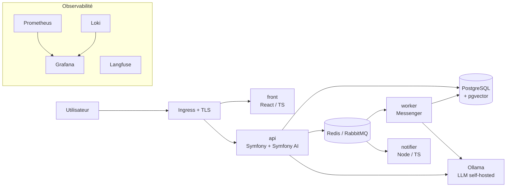

# 🚀 TaskPilot — DevOps & AI Platform

> Une application de gestion de tâches augmentée par l'IA, **construite, déployée et exploitée comme en production** : conteneurs, CI/CD, Kubernetes, GitOps, Infra as Code, observabilité et LLM self-hosted.


---

## 🎯 Objectif du projet

Ce dépôt est un **projet d'apprentissage et de démonstration**. L'application est volontairement simple ; l'enjeu est tout ce qui l'entoure :

- livrer automatiquement chaque commit, de façon sûre et reproductible ;
- décrire toute l'infrastructure en code ;
- observer, alerter et scaler en production ;
- intégrer et exploiter un LLM self-hosted comme un vrai service.

---

## 🏗️ Architecture



| Service | Stack | Rôle |
|---|---|---|
| `api` | PHP 8.x, Symfony, Symfony AI | API REST, agent IA (tools, RAG), serveur MCP |
| `worker` | même image que `api` | Indexation vectorielle asynchrone (`messenger:consume`) |
| `notifier` | Node.js, TypeScript | Consomme les événements et envoie les notifications |
| `front` | React, TypeScript | Interface utilisateur |
| `ollama` | Ollama | Sert un LLM open source sur CPU |

---

## 🧰 Stack technique

| Domaine | Outils |
|---|---|
| Conteneurs | Docker (multi-stage, multi-arch), Docker Compose |
| CI/CD | GitHub Actions, GHCR, Trivy |
| Orchestration | Kubernetes (kind / k3s), Helm |
| Infra as Code | Terraform / OpenTofu |
| GitOps | ArgoCD |
| Observabilité | Prometheus, Grafana, Loki, Alertmanager, Langfuse |
| Scaling | HPA, KEDA |
| Sécurité | External Secrets, cert-manager, images non-root |
| IA | Symfony AI (Platform, Agent, Store, MCP), Ollama, pgvector, K8sGPT |

---

## 🗺️ Roadmap

- [ ] **Niveau 1 — Conteneurisation** : Dockerfiles multi-stage, non-root, `docker compose up` fonctionnel
- [ ] **Niveau 2 — CI/CD** : lint, tests, build, scan Trivy, push GHCR (tags = SHA du commit)
- [ ] **Niveau 3 — Kubernetes local** : chart Helm, probes, limits, migrations en Job, 2 replicas
- [ ] **Niveau 4 — Terraform & cloud** : réseau, cluster k3s, state distant, staging / prod
- [ ] **Niveau 5 — GitOps** : ArgoCD, rollback par `git revert`
- [ ] **Niveau 6 — Observabilité** : golden signals, alertes, HPA validé par un test de charge k6
- [ ] **Niveau 7 — Symfony AI en production** : agent + tools, RAG pgvector, indexation async scalée par KEDA, MCP, évaluations IA en CI
- [ ] **Bonus** : TLS automatique, K8sGPT, alertes résumées par l'IA, postmortem

---

## ⚡ Démarrage rapide

### Prérequis
- Docker et Docker Compose
- 16 Go de RAM recommandés (8 Go sans la stack d'observabilité)

### Lancer en local
```bash
git clone https://github.com/<ton-pseudo>/taskpilot-devops.git
cd taskpilot-devops
cp .env.example .env
docker compose up -d
```

| URL | Service |
|---|---|
| http://localhost:3000 | Front |
| http://localhost:8080/api | API |
| http://localhost:3001 | Grafana (niveau 6) |

### Lancer sur Kubernetes local (niveau 3)
```bash
kind create cluster --name taskpilot
helm install taskpilot ./deploy/helm/taskpilot -f ./deploy/helm/values-local.yaml
```

---

## 📁 Structure du dépôt

```
taskpilot-devops/
├── apps/
│   ├── api/            # Symfony + Symfony AI
│   ├── notifier/       # Node.js / TypeScript
│   └── front/          # React / TypeScript
├── deploy/
│   ├── helm/           # Charts Helm et values par environnement
│   ├── argocd/         # Applications ArgoCD
│   └── observability/  # Dashboards Grafana, règles d'alerte
├── infra/
│   └── terraform/      # Infrastructure cloud
├── docs/
│   ├── architecture.md
│   ├── decisions/      # ADR : choix techniques et compromis
│   └── runbooks/       # Procédures d'exploitation et postmortems
├── .github/workflows/  # Pipelines CI/CD
├── docker-compose.yml
└── README.md
```

---

## 🧠 Choix techniques et compromis

Chaque décision importante est documentée dans [`docs/decisions/`](docs/decisions/) au format ADR (contexte, décision, alternatives, conséquences). Quelques exemples :

| Décision | Pourquoi | Alternative écartée |
|---|---|---|
| k3s plutôt qu'EKS | Gratuit, léger, même API Kubernetes | EKS : ~70 $/mois pour le control plane |
| Ollama self-hosted | Coût nul, aucune donnée envoyée à l'extérieur | API externe : coût et dépendance |
| Symfony AI dans l'API | Cohérence avec la stack, injection de dépendances, Profiler | Service IA séparé en Node |
| Tags d'image = SHA | Traçabilité et rollback fiables | `latest` : non reproductible |

---

## 💰 Coût d'exploitation

**0 €** : outils open source, GitHub Actions et GHCR gratuits sur dépôt public, Oracle Cloud Always Free pour l'hébergement, LLM local via Ollama.

---

## 👤 Auteur

**<Ton nom>** — Développeur backend PHP Symfony / Node.js / React / TypeScript, en montée en compétences DevOps et IA.

[LinkedIn](https://www.linkedin.com/in/<ton-profil>) · [GitHub](https://github.com/<ton-pseudo>)

## 📄 Licence

MIT
